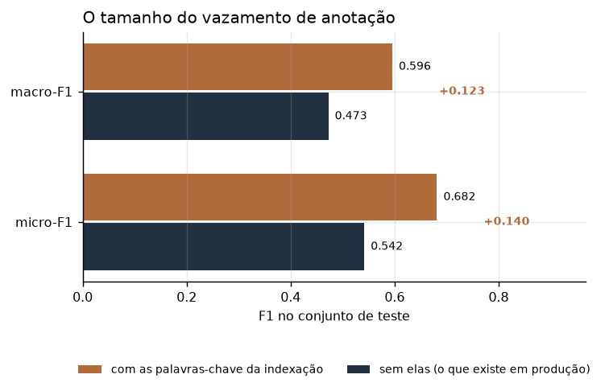
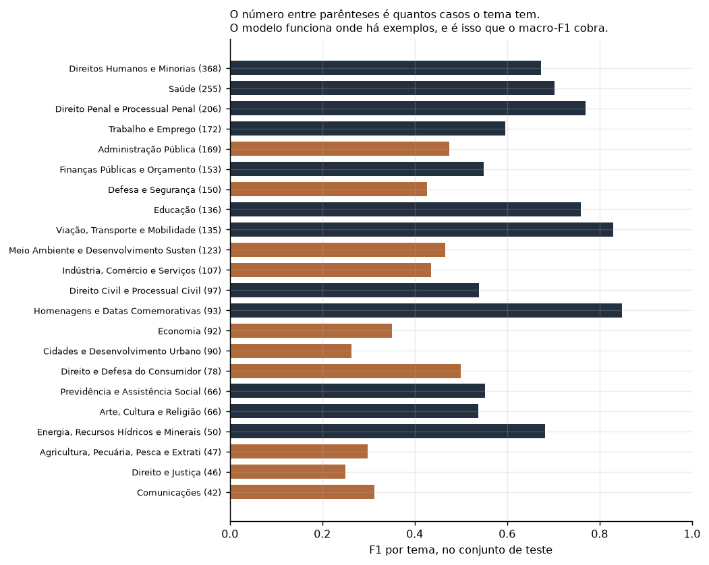

# Verbete

Classifica **projetos de lei por tema**, a partir da ementa, usando a taxonomia
oficial de 32 temas da Câmara dos Deputados. É o motor de um produto de
monitoramento regulatório: saber, no dia em que a proposição é apresentada,
quais clientes ela afeta.

**Os números no ar:** [https://fabriciojunio.vercel.app/resultados/verbete](https://fabriciojunio.vercel.app/resultados/verbete) · a curva de abstenção, com cobertura de um lado e F1 do outro, sem precisar rodar nada.

```
python experimentos/01_coletar.py --anos 2022 2023 2024 --maximo-por-ano 1500
python experimentos/02_treinar.py --ano-de-teste 2024
python experimentos/03_abstencao_e_explicacao.py
python experimentos/04_figuras.py
python -m pytest testes/ -q          # 41 testes
```

## Em um parágrafo

4.500 projetos de lei de 2022 a 2024, cada um com os temas que a indexação da
Câmara atribuiu. 99,9% têm ao menos um tema. O problema é multirrótulo, a
taxonomia é desigual (o tema mais comum tem 1.207 casos, o mais raro tem 14), e
a decisão de produto não é "qual o F1" e sim **"com que cobertura eu consigo que
F1"**, porque classificar errado custa mais do que não opinar.

## O resultado principal: o tamanho do vazamento de anotação

O campo `keywords` da API é preenchido **pela mesma indexação humana que atribui
o tema**, no mesmo momento. Usá-lo como variável é usar parte do trabalho que
produziu o rótulo. O projeto treina o mesmo modelo com e sem ele:

| | micro-F1 | macro-F1 |
|---|---|---|
| sem as palavras-chave (**o que existe em produção**) | **0,542** | **0,473** |
| com as palavras-chave da indexação | 0,682 | 0,596 |
| diferença | **+0,140** | **+0,123** |

Um modelo que usasse as palavras-chave pareceria **26% melhor** do que vai ser
no dia em que a proposição chegar sem indexação nenhuma. Esse número não aparece
sozinho: ele só existe porque alguém perguntou de onde a variável vem.



## De quanto o modelo ganha de não ter modelo

| modelo | micro-F1 | macro-F1 | acerto exato | ao menos um certo |
|---|---|---|---|---|
| sempre os temas mais frequentes | 0,212 | 0,023 | 0,033 | 0,354 |
| regra por palavra do nome do tema | 0,294 | 0,263 | 0,075 | 0,675 |
| **TF-IDF com logística por tema** | **0,542** | **0,473** | 0,199 | 0,853 |

Ganho de **2,56x** sobre não ler o texto e de **1,84x** sobre a regra de
dicionário. A regra de dicionário não é espantalho: ela é o que alguém monta
numa tarde, e ela sozinha já acerta um dos temas em dois terços dos casos.

**A distância entre micro e macro é o resultado**, não um detalhe: 0,069. Ela
mede o quanto o modelo funciona apenas nos temas comuns. Reportar só o micro-F1
esconderia que a taxonomia inteira não está coberta.

## Quando o modelo deve calar

Num produto de monitoramento, errar o tema manda o documento para a mesa errada
e isso só é descoberto tarde. A pergunta de produto é a curva de cobertura:

| corte de confiança | cobertura | micro-F1 | macro-F1 |
|---|---|---|---|
| 0,358 | 99,9% | 0,542 | 0,473 |
| 0,636 | 80,0% | 0,604 | 0,534 |
| 0,835 | 50,0% | 0,653 | 0,591 |
| 0,972 | 10,0% | 0,694 | 0,610 |

**A resposta honesta é que não dá.** O alvo de 0,70 de micro-F1 não é alcançado
em cobertura nenhuma: o melhor ponto da curva é 0,694, respondendo 10% dos
casos. Com este modelo, apertar o corte de confiança não compra qualidade
suficiente, e o caminho é melhorar o modelo e não o corte.

Ganho máximo ao abster: **+0,152** de micro-F1, custando 90% da vazão.

## A explicação vem do modelo que decide

O classificador é linear de propósito. Num setor regulado alguém vai perguntar
por que a proposição foi para a mesa de tributário, e com modelo linear a
resposta são os coeficientes do **próprio** classificador, não uma aproximação
posterior. Explicação que não vem do modelo que decidiu é uma segunda opinião.

**Onde ele acerta, e o que pesa:**

| tema | F1 | casos | termos de maior peso |
|---|---|---|---|
| Homenagens e Datas Comemorativas | 0,85 | 93 | dia, nacional, denomina, declara |
| Viação, Transporte e Mobilidade | 0,83 | 135 | transporte, trânsito, veículos, passageiros |
| Direito Penal e Processual Penal | 0,77 | 206 | penal, crimes, decreto, crime |
| Educação | 0,76 | 136 | educação, ensino, escolas, escolar |
| Saúde | 0,70 | 255 | saúde, medicamentos, doenças, tratamento |

**Onde ele erra, e por quê:**

| tema | F1 | casos | leitura |
|---|---|---|---|
| Direito Constitucional | 0,01 | 7 | sete casos no teste: não há o que aprender |
| Relações Internacionais | 0,17 | 12 | idem, e os termos que ele pegou são genéricos |
| Direito e Justiça | 0,25 | 46 | tema guarda-chuva, sobrepõe com quase todos |
| Esporte e Lazer | 0,26 | 36 | os termos estão certos (atletas, futebol), falta volume |

O padrão é claro e vale como diagnóstico: **o modelo funciona onde há exemplos**,
e é exatamente isso que o macro-F1 cobra e o micro-F1 esconde.



## As decisões que mudam o número

- **divisão temporal, não aleatória.** Proposição sobre o mesmo assunto reaparece
  a cada legislatura com ementa quase igual. Com divisão aleatória, a quase-cópia
  de 2023 cai no treino e a outra no teste, e o modelo parece entender texto
  quando está reconhecendo texto que já viu. Treino em 2022 e 2023, teste em
  2024, que é também o uso real: treinar no passado e rodar no que chega amanhã;
- **um limiar por tema, ajustado na validação.** Limiar único para 32 temas de
  frequências muito diferentes é simplicidade falsa: o corte que serve para um
  tema com 900 casos nunca dispara para um com 12;
- **`class_weight="balanced"`.** Sem ele os temas raros nunca disparam, o
  macro-F1 desaba e o micro-F1 continua bonito;
- **rótulo sem casos no conjunto fica fora da média macro.** F1 de um rótulo que
  não aparece é indefinido, não zero, e contá-lo como zero puniria o modelo por
  um rótulo que ele não teve chance de acertar;
- **acentos removidos na normalização.** Decisão com custo: "público" e "publico"
  viram a mesma coisa, o que ajuda, mas também colide palavras diferentes. Vale
  aqui porque a ementa é escrita por muitas mãos e a acentuação varia, e um termo
  escrito dos dois jeitos viraria dois termos com metade da frequência cada.

## Por que não um transformador

Ele provavelmente ganharia. Não está aqui porque o projeto não teria como medir o
ganho de forma honesta sem GPU e sem tempo de ajuste, e um número de um modelo
mal ajustado é pior que nenhum número. O limite está declarado em vez de
disfarçado, e o caminho está aberto: a interface dos candidatos é a mesma, e
acrescentar um quarto modelo não muda nada no resto do projeto.

## O que este projeto não é

- **não é um produto pronto.** Com micro-F1 de 0,542 ele serve para priorizar uma
  fila de leitura humana, não para substituí-la;
- **não vale para outra taxonomia.** Os 32 temas são os da Câmara, e a lista veio
  da API, não foi inventada aqui;
- **não lê o inteiro teor.** A API traz o link do PDF, e usá-lo mudaria o
  problema: mais texto, mais custo e provavelmente mais F1. O recorte está na
  ementa de propósito, porque é o que existe no minuto em que a proposição é
  apresentada.

## Estrutura

```
verbete/dominio/      avaliacao (multirrotulo, abstencao, limiar por rotulo)
verbete/aplicacao/    classificador (os tres candidatos e a normalizacao)
verbete/adaptadores/  camara (API de dados abertos, com paginacao e falhas)
experimentos/         01 coletar, 02 treinar, 03 abstencao, 04 figuras
testes/               41 testes
```

Nenhum teste chama a API. O que se verifica é a lógica de métrica e de modelo,
com corpus sintético de resposta conhecida, porque teste que depende de serviço
externo quebra a integração contínua por motivo que não tem a ver com o código.

## Fonte

Dados abertos da Câmara dos Deputados,
`https://dadosabertos.camara.leg.br/api/v2`. Sem chave, sem cadastro. A
taxonomia de temas vem de `/referencias/proposicoes/codTema`, e o recorte
baixado está em `resultados/cartao_do_dado.json` com data e contagem.

## Referências conferidas

- Tsoumakas, G.; Katakis, I. (2007). *Multi-label classification: an overview*
- Benjamini, Y.; Hochberg, Y. (1995). *Controlling the false discovery rate*
- Peduzzi, P. et al. (1996). *A simulation study of the number of events per
  variable in logistic regression analysis*
- Câmara dos Deputados, Tabela de Temas das Proposições
